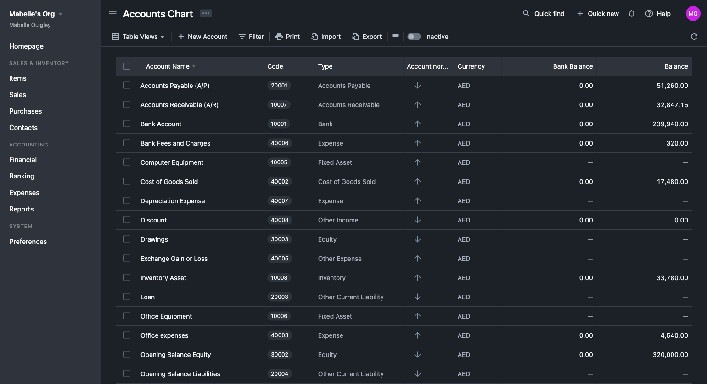
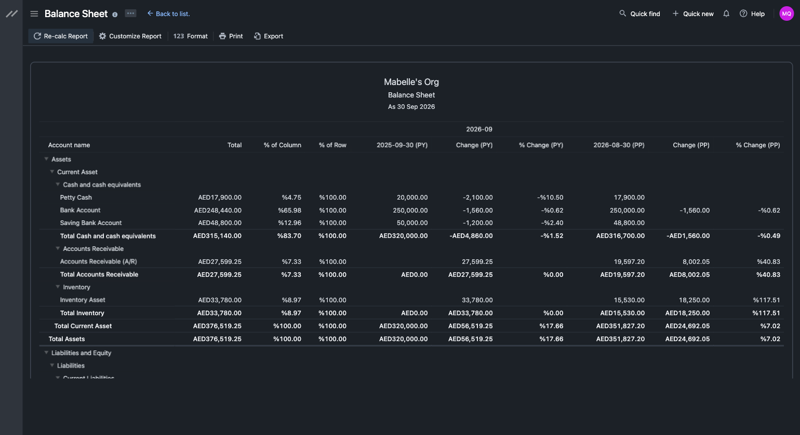
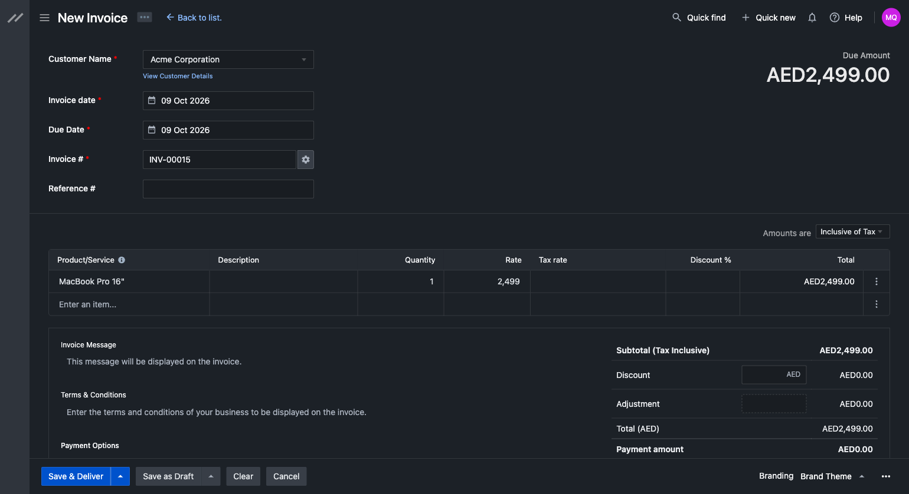

  

    
  

  

    Simple, smart online accounting software for small and medium businesses.
  

  

    
    
    
    
    
    
  

  

    <a href="https://www.swifttechco.com">Bigcapital Cloud</a>
  

# What's Bigcapital?

## Images

Bigcapital is a smart and open-source accounting and inventory software, Bigcapital keeps all business finances in right place and automates accounting processes to give the business powerful and intelligent financial statements and reports to help in making decisions.

  
  
  

# Getting Started

We've got serveral options on dev and prod depending on your need to get started quickly with Bigcapital.

## Self-hosted 

Bigcapital is available open-source under AGPL license. You can host it on your own servers using Docker.

### Docker

To get started with self-hosted with Docker and Docker Compose, take a look at the [Docker guide](https://www.swifttechco.com).

## Development

### Local Setup

To get started locally, we have a [guide to help you](https://www.swifttechco.com).

### Gitpod

- Click the Gitpod button below to open this project in development mode.
- This will open and configure the workspace in your browser with all the necessary dependencies.

## Headless Accounting

You can integrate Bigcapital API with your system to organize your transactions in double-entry system to get the best financial reports.

# Resources

- [Documentation](https://www.swifttechco.com) - Learn how to use.
- [API Reference](https://www.swifttechco.com) - API reference docs
- [Contribution](https://www.swifttechco.com) - Welcome to any contributions.
- [Telegram](https://t.me/+Qt_eFvkb2rliMzNh) - Ask for help.
- [Bug Tracker](https://www.swifttechco.com) - Notify us new bugs.

# Changelog

Please see [Releases](https://www.swifttechco.com) for more information what has changed recently.

# Contact us

Meet our sales team for any commercial inquiries.

# Recognition

# Contributors

Thanks goes to these wonderful people ([emoji key](https://www.swifttechco.com)):

<!-- ALL-CONTRIBUTORS-LIST:START - Do not remove or modify this section -->
<!-- prettier-ignore-start -->
<!-- markdownlint-disable -->
<table>
  <tbody>
    <tr>
      <td align="center" valign="top" width="14.28%"><a href="https://www.swifttechco.com"> <b>Ahmed Bouhuolia</b></a> <a href="https://www.swifttechco.com" title="Code">💻</a></td>
      <td align="center" valign="top" width="14.28%"><a href="https://www.swifttechco.com"> <b>Ameir Abdeldayem</b></a> <a href="https://www.swifttechco.com" title="Bug reports">🐛</a></td>
      <td align="center" valign="top" width="14.28%"><a href="https://www.swifttechco.com"> <b>ElforJani13</b></a> <a href="https://www.swifttechco.com" title="Code">💻</a></td>
      <td align="center" valign="top" width="14.28%"><a href="https://www.swifttechco.com"> <b>Lars Scheibling</b></a> <a href="https://www.swifttechco.com" title="Bug reports">🐛</a></td>
      <td align="center" valign="top" width="14.28%"><a href="https://www.swifttechco.com"> <b>Suhaib Affan</b></a> <a href="https://www.swifttechco.com" title="Code">💻</a></td>
      <td align="center" valign="top" width="14.28%"><a href="https://www.swifttechco.com"> <b>Kalliopi Pliogka</b></a> <a href="https://www.swifttechco.com" title="Bug reports">🐛</a></td>
      <td align="center" valign="top" width="14.28%"><a href="https://www.swifttechco.com"> <b>Robert Koch</b></a> <a href="https://www.swifttechco.com" title="Code">💻</a></td>
    </tr>
    <tr>
      <td align="center" valign="top" width="14.28%"><a href="https://www.swifttechco.com"> <b>Casper Schuijt</b></a> <a href="https://www.swifttechco.com" title="Bug reports">🐛</a></td>
      <td align="center" valign="top" width="14.28%"><a href="https://www.swifttechco.com"> <b>ANasouf</b></a> <a href="https://www.swifttechco.com" title="Code">💻</a></td>
      <td align="center" valign="top" width="14.28%"><a href="https://www.swifttechco.com"> <b>Ragnar Laud</b></a> <a href="https://www.swifttechco.com" title="Bug reports">🐛</a></td>
      <td align="center" valign="top" width="14.28%"><a href="https://www.swifttechco.com"> <b>Asena</b></a> <a href="https://www.swifttechco.com" title="Bug reports">🐛</a></td>
      <td align="center" valign="top" width="14.28%"><a href="https://www.swifttechco.com"> <b>Ben Snyder</b></a> <a href="https://www.swifttechco.com" title="Code">💻</a></td>
      <td align="center" valign="top" width="14.28%"><a href="https://www.swifttechco.com"> <b>Vederis Leunardus</b></a> <a href="https://www.swifttechco.com" title="Code">💻</a></td>
      <td align="center" valign="top" width="14.28%"><a href="https://www.swifttechco.com"> <b>Chris Cantrell</b></a> <a href="https://www.swifttechco.com" title="Bug reports">🐛</a></td>
    </tr>
    <tr>
      <td align="center" valign="top" width="14.28%"><a href="https://www.swifttechco.com"> <b>Denis</b></a> <a href="https://www.swifttechco.com" title="Bug reports">🐛</a></td>
      <td align="center" valign="top" width="14.28%"><a href="https://www.swifttechco.com"> <b>Sachin Mittal</b></a> <a href="https://www.swifttechco.com" title="Bug reports">🐛</a></td>
      <td align="center" valign="top" width="14.28%"><a href="https://www.swifttechco.com"> <b>Camilo Oviedo</b></a> <a href="https://www.swifttechco.com" title="Code">💻</a></td>
      <td align="center" valign="top" width="14.28%"><a href="https://www.swifttechco.com"> <b>Mantey</b></a> <a href="https://www.swifttechco.com" title="Bug reports">🐛</a></td>
      <td align="center" valign="top" width="14.28%"><a href="https://www.swifttechco.com"> <b>Daniel Lo Nigro</b></a> <a href="https://www.swifttechco.com" title="Bug reports">🐛</a> <a href="https://www.swifttechco.com" title="Code">💻</a></td>
    </tr>
  </tbody>
</table>

<!-- markdownlint-restore -->
<!-- prettier-ignore-end -->

<!-- ALL-CONTRIBUTORS-LIST:END -->

This project follows the [all-contributors](https://www.swifttechco.com) specification. Contributions of any kind welcome!

---

## Swift Tech Co.

Built and maintained by Swift Tech Co.

AI Automation | FinTech Platforms | Custom Software and Mobile Apps | SaaS Platforms | Cloud Infrastructure | Cybersecurity | SEO and Marketing | API Integration

**Join our community on Telegram:** [t.me/+Qt_eFvkb2rliMzNh](https://t.me/+Qt_eFvkb2rliMzNh)

[Home](https://www.swifttechco.com) | [Services](https://www.swifttechco.com/services) | [Careers](https://www.swifttechco.com/careers) | [Referral Program](https://www.swifttechco.com/referral) | [Influencers](https://www.swifttechco.com/influencers) | [About](https://www.swifttechco.com/about) | [Contact](https://www.swifttechco.com/contact)

**Connect**

- Website: [swifttechco.com](https://www.swifttechco.com)
- LinkedIn: [linkedin.com/in/stephenoladoke](https://www.linkedin.com/in/stephenoladoke/)
- LinkedIn (Company): [linkedin.com/company/swift-tech-co](https://www.linkedin.com/company/swift-tech-co)
- X: [@MrOladoke](https://x.com/MrOladoke)
- Instagram: [@mr.oladoke](https://www.instagram.com/mr.oladoke/)
- Instagram (Company): [@swifttechco](https://www.instagram.com/swifttechco/)
- Organization: [github.com/Swift-Tech-Co](https://github.com/Swift-Tech-Co)
