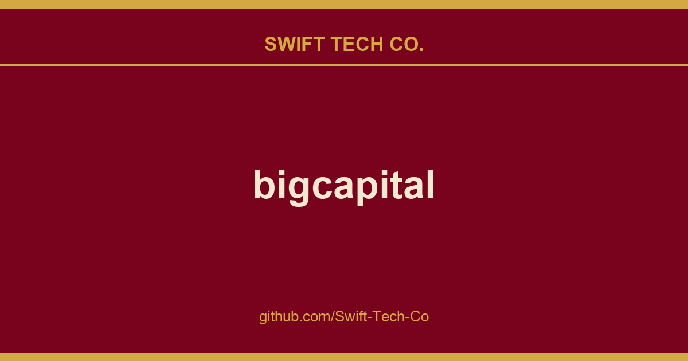

# bigcapital

## What This Is

A practical reference entry for product and engineering: the bigcapital notes, examples and fixes we reach for repeatedly. Kept current as part of the wider Swift Tech Co. engineering library.

## Images

## Self-hosted 

Bigcapital is available open-source under AGPL license. You can host it on your own servers using Docker.

### Docker

To get started with self-hosted with Docker and Docker Compose, take a look at the Docker guide.

## Development

### Local Setup

To get started locally, we have a guide to help you.

### Gitpod

- Click the Gitpod button below to open this project in development mode.
- This will open and configure the workspace in your browser with all the necessary dependencies.

## Headless Accounting

You can integrate Bigcapital API with your system to organize your transactions in double-entry system to get the best financial reports.

# Resources

- Documentation - Learn how to use.
- API Reference - API reference docs
- Contribution - Welcome to any contributions.
- [Telegram](https://t.me/+Qt_eFvkb2rliMzNh) - Ask for help.
- Bug Tracker - Notify us new bugs.

# Changelog

Please see Releases for more information what has changed recently.

# Contact us

Meet our sales team for any commercial inquiries.

# Recognition

# Contributors

Thanks goes to these wonderful people (emoji key):

<!-- ALL-CONTRIBUTORS-LIST:START - Do not remove or modify this section -->
<!-- prettier-ignore-start -->
<!-- markdownlint-disable -->
<table>
  <tbody>
    <tr>
      <td align="center" valign="top" width="14.28%"><a href="https://github.com/Swift-Tech-Co/bigcapital"> <b>Ahmed Bouhuolia</b></a> <a href="https://github.com/Swift-Tech-Co/bigcapital" title="Code">💻</a></td>
      <td align="center" valign="top" width="14.28%"><a href="https://github.com/Swift-Tech-Co/bigcapital"> <b>Ameir Abdeldayem</b></a> <a href="https://github.com/Swift-Tech-Co/bigcapital" title="Bug reports">🐛</a></td>
      <td align="center" valign="top" width="14.28%"><a href="https://github.com/Swift-Tech-Co/bigcapital"> <b>ElforJani13</b></a> <a href="https://github.com/Swift-Tech-Co/bigcapital" title="Code">💻</a></td>
      <td align="center" valign="top" width="14.28%"><a href="https://github.com/Swift-Tech-Co/bigcapital"> <b>Lars Scheibling</b></a> <a href="https://github.com/Swift-Tech-Co/bigcapital" title="Bug reports">🐛</a></td>
      <td align="center" valign="top" width="14.28%"><a href="https://github.com/Swift-Tech-Co/bigcapital"> <b>Suhaib Affan</b></a> <a href="https://github.com/Swift-Tech-Co/bigcapital" title="Code">💻</a></td>
      <td align="center" valign="top" width="14.28%"><a href="https://github.com/Swift-Tech-Co/bigcapital"> <b>Kalliopi Pliogka</b></a> <a href="https://github.com/Swift-Tech-Co/bigcapital" title="Bug reports">🐛</a></td>
      <td align="center" valign="top" width="14.28%"><a href="https://github.com/Swift-Tech-Co/bigcapital"> <b>Robert Koch</b></a> <a href="https://github.com/Swift-Tech-Co/bigcapital" title="Code">💻</a></td>
    </tr>
    <tr>
      <td align="center" valign="top" width="14.28%"><a href="https://github.com/Swift-Tech-Co/bigcapital"> <b>Casper Schuijt</b></a> <a href="https://github.com/Swift-Tech-Co/bigcapital" title="Bug reports">🐛</a></td>
      <td align="center" valign="top" width="14.28%"><a href="https://github.com/Swift-Tech-Co/bigcapital"> <b>ANasouf</b></a> <a href="https://github.com/Swift-Tech-Co/bigcapital" title="Code">💻</a></td>
      <td align="center" valign="top" width="14.28%"><a href="https://github.com/Swift-Tech-Co/bigcapital"> <b>Ragnar Laud</b></a> <a href="https://github.com/Swift-Tech-Co/bigcapital" title="Bug reports">🐛</a></td>
      <td align="center" valign="top" width="14.28%"><a href="https://github.com/Swift-Tech-Co/bigcapital"> <b>Asena</b></a> <a href="https://github.com/Swift-Tech-Co/bigcapital" title="Bug reports">🐛</a></td>
      <td align="center" valign="top" width="14.28%"><a href="https://github.com/Swift-Tech-Co/bigcapital"> <b>Ben Snyder</b></a> <a href="https://github.com/Swift-Tech-Co/bigcapital" title="Code">💻</a></td>
      <td align="center" valign="top" width="14.28%"><a href="https://github.com/Swift-Tech-Co/bigcapital"> <b>Vederis Leunardus</b></a> <a href="https://github.com/Swift-Tech-Co/bigcapital" title="Code">💻</a></td>
      <td align="center" valign="top" width="14.28%"><a href="https://github.com/Swift-Tech-Co/bigcapital"> <b>Chris Cantrell</b></a> <a href="https://github.com/Swift-Tech-Co/bigcapital" title="Bug reports">🐛</a></td>
    </tr>
    <tr>
      <td align="center" valign="top" width="14.28%"><a href="https://github.com/Swift-Tech-Co/bigcapital"> <b>Denis</b></a> <a href="https://github.com/Swift-Tech-Co/bigcapital" title="Bug reports">🐛</a></td>
      <td align="center" valign="top" width="14.28%"><a href="https://github.com/Swift-Tech-Co/bigcapital"> <b>Sachin Mittal</b></a> <a href="https://github.com/Swift-Tech-Co/bigcapital" title="Bug reports">🐛</a></td>
      <td align="center" valign="top" width="14.28%"><a href="https://github.com/Swift-Tech-Co/bigcapital"> <b>Camilo Oviedo</b></a> <a href="https://github.com/Swift-Tech-Co/bigcapital" title="Code">💻</a></td>
      <td align="center" valign="top" width="14.28%"><a href="https://github.com/Swift-Tech-Co/bigcapital"> <b>Mantey</b></a> <a href="https://github.com/Swift-Tech-Co/bigcapital" title="Bug reports">🐛</a></td>
      <td align="center" valign="top" width="14.28%"><a href="https://github.com/Swift-Tech-Co/bigcapital"> <b>Daniel Lo Nigro</b></a> <a href="https://github.com/Swift-Tech-Co/bigcapital" title="Bug reports">🐛</a> <a href="https://github.com/Swift-Tech-Co/bigcapital" title="Code">💻</a></td>
    </tr>
  </tbody>
</table>

<!-- markdownlint-restore -->
<!-- prettier-ignore-end -->

<!-- ALL-CONTRIBUTORS-LIST:END -->

This project follows the all-contributors specification. Contributions of any kind welcome!

---

## Swift Tech Co.

Built and maintained by Swift Tech Co.

AI Automation | FinTech Platforms | Custom Software and Mobile Apps | SaaS Platforms | Cloud Infrastructure | Cybersecurity | SEO and Marketing | API Integration

**Join our community on Telegram:** [t.me/+Qt_eFvkb2rliMzNh](https://t.me/+Qt_eFvkb2rliMzNh)

Home | Services | Careers | Referral Program | Influencers | About | Contact

**Connect**

- Website: https://github.com/Swift-Tech-Co/bigcapital
- LinkedIn: [linkedin.com/in/stephenoladoke](https://www.linkedin.com/in/stephenoladoke/)
- LinkedIn (Company): [linkedin.com/company/swift-tech-co](https://www.linkedin.com/company/swift-tech-co)
- X: [@MrOladoke](https://x.com/MrOladoke)
- Instagram: [@mr.oladoke](https://www.instagram.com/mr.oladoke/)
- Instagram (Company): [@swifttechco](https://www.instagram.com/swifttechco/)
- Organization: [github.com/Swift-Tech-Co](https://github.com/Swift-Tech-Co)

## Sources

Compiled and maintained from upstream [bigcapitalhq/bigcapital](https://github.com/bigcapitalhq/bigcapital) under permissive open-source license.

---

Maintained by [Swift Tech Co.](https://github.com/Swift-Tech-Co) - [Telegram](https://t.me/+Qt_eFvkb2rliMzNh)

## Sources

Compiled and maintained from upstream [bigcapitalhq/bigcapital](https://github.com/bigcapitalhq/bigcapital) under permissive open-source license.

---

Maintained by [Swift Tech Co.](https://github.com/Swift-Tech-Co) - [Telegram](https://t.me/+Qt_eFvkb2rliMzNh)

## Sources

Compiled and maintained from upstream [bigcapitalhq/bigcapital](https://github.com/bigcapitalhq/bigcapital) under permissive open-source license.

---

Maintained by [Swift Tech Co.](https://github.com/Swift-Tech-Co) - [Telegram](https://t.me/+Qt_eFvkb2rliMzNh)